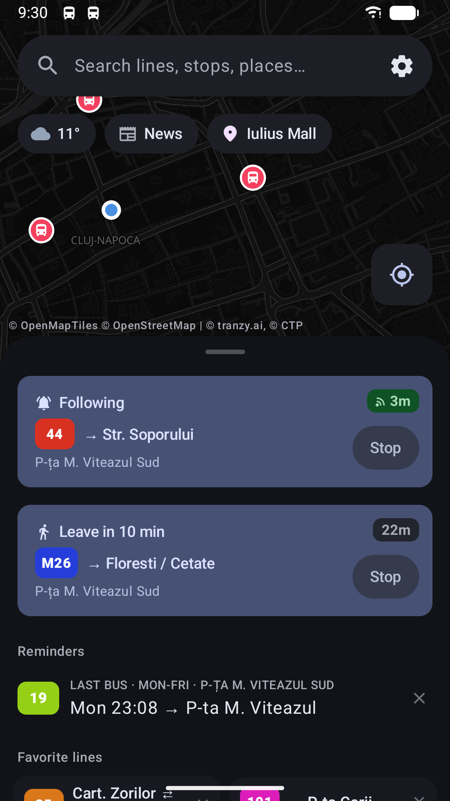
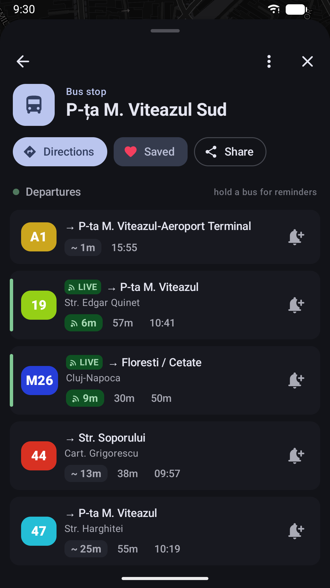
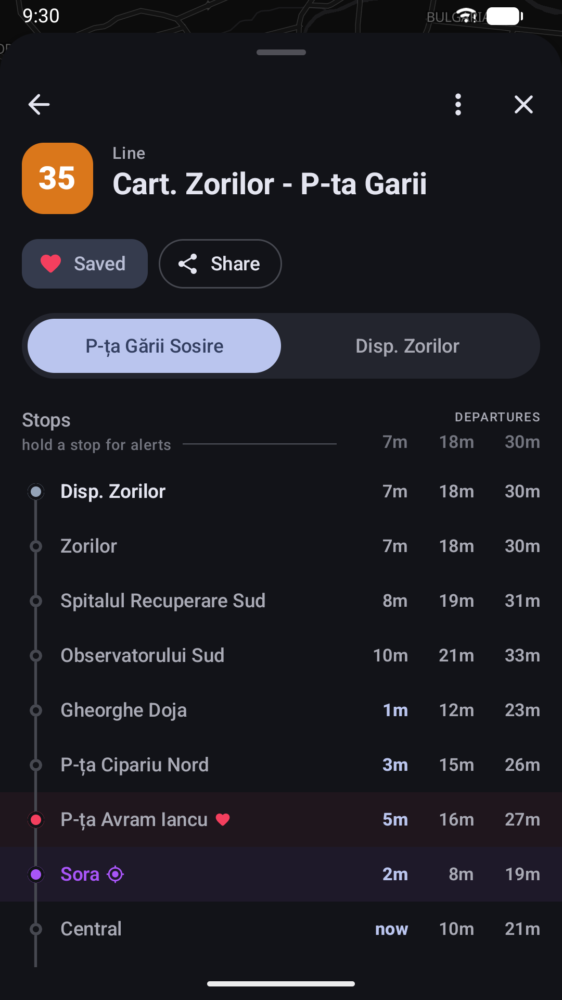
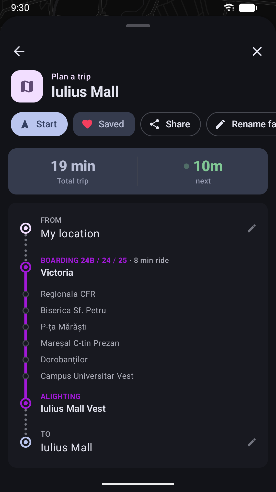

# Conexiuni Cluj for Android

The [Conexiuni Cluj](https://github.com/bmarian/conexiuni-cluj) bus and tram tracker as an Android app. Same buses and timetables as the website, laid out like Google Maps.

**[Download the latest APK](https://github.com/bmarian/conexiuni-cluj-mobile/releases/latest/download/conexiuni-cluj.apk)** (Android 14 or newer)

<p align="center">
  
  
  
  
</p>

## What it does

- Every CTP bus and tram on the map, live
- The stops around you and their next buses, on the first screen
- Departures for any stop. Tracked buses get a live countdown, the rest show the timetable
- Full timetables for every line
- A route planner: leave now, leave at, arrive by, or the last one today
- Step-by-step guidance for a planned trip, with voice
- Follow a bus and get told when to leave and when it comes
- Reminders for the buses you take often, and an alarm before your stop
- Favorite stops and lines
- A home screen widget for a stop
- Share a place to the app and it plans the trip there
- A notification when CTP changes a line you follow
- Works with the [Wear OS app](https://github.com/bmarian/conexiuni-cluj-wearos)
- Move your favorites and settings to another phone, the website or your watch by scanning a code

---

## Running it yourself

You'll need Android Studio with the Android SDK. The map needs no key.

```bash
./gradlew installDebug
```

```bash
./gradlew testDebugUnitTest
```

**With a watch connected**, pick the phone with `ANDROID_SERIAL=<serial> ./gradlew installDebug`. Both apps use the package name `online.bmarian.bus`, so a plain install replaces the watch app.

**The logic** is the website's, ported to Kotlin in [`logic/`](app/src/main/java/online/bus/bmarian/conexiuniclujmobile/logic). The parity tests run both on the same real data and fail if anything differs. Their fixtures come from [`tools/parity`](tools/parity).

**The watch app** has to be signed with the same key as this one, or they can't talk to each other.

**Releasing** needs a `keystore.properties` next to this README. Git ignores it.

```properties
storeFile=../keys/upload.jks
storePassword=...
keyAlias=upload
keyPassword=...
```

Phone version codes are 1xxxx and the watch's 2xxxx. `./gradlew bundleRelease` builds the bundle for Google Play and `./gradlew assembleRelease` the APK. The privacy policy for both apps is [`PRIVACY.md`](PRIVACY.md).

## Credits

| Source                                                       | Used for                                             |
| ------------------------------------------------------------ | ---------------------------------------------------- |
| [Tranzy.ai](https://tranzy.ai/)                              | Live GPS positions and GTFS data for CTP Cluj-Napoca |
| [CTP Cluj-Napoca](https://www.ctpcj.ro/)                     | Official timetables                                  |
| [Open-Meteo](https://open-meteo.com/)                        | Weather data                                         |
| [OpenStreetMap](https://www.openstreetmap.org/) contributors | Map data                                             |
| [OpenFreeMap](https://openfreemap.org/)                      | Map tiles                                            |
| [MapLibre](https://maplibre.org/)                            | The map                                              |
| [Photon](https://photon.komoot.io/)                          | Place search                                         |
| [OpenTripPlanner](https://www.opentripplanner.org/)          | Route planning                                       |
| [ZXing](https://github.com/zxing/zxing)                      | QR codes                                             |
