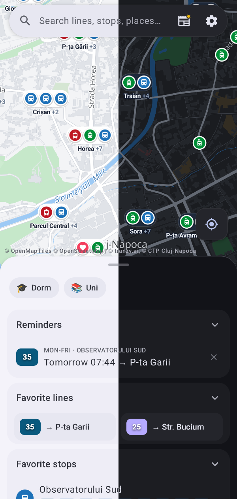
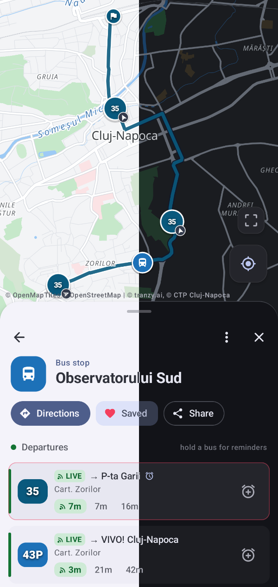
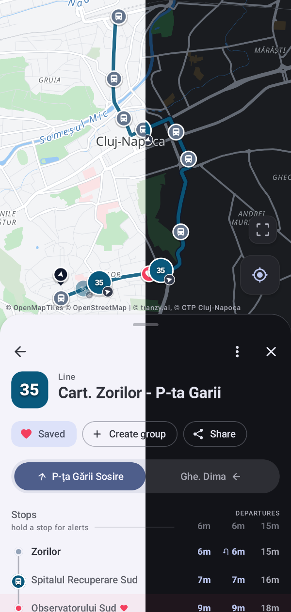
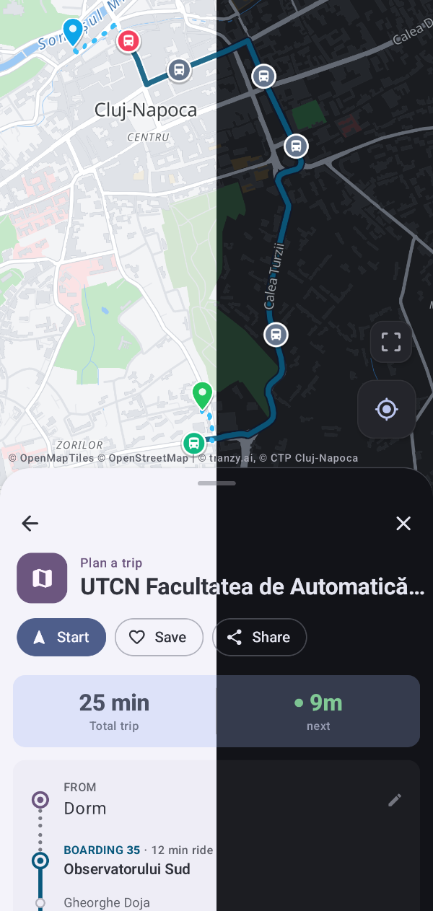

# Ce autobuz iau? for Android

The [Ce autobuz iau?](https://github.com/bmarian/conexiuni-cluj) bus, tram and trolleybus tracker as an Android app.

**[Get it on Google Play](https://play.google.com/store/apps/details?id=online.bmarian.bus).** Needs Android 8 or newer.

<p align="center">
  
  
  
  
</p>

## What it does

- Live buses, trams and trolleybuses on the map
- Departures for any stop. Tracked buses get a live countdown, the rest show approximate times
- Full timetables for every line
- A route planner: leave now, leave at, arrive by, or the last one today
- Step-by-step guidance for a planned trip, with voice, and an alarm before your stop
- Follow a bus, the countdown stays in your notifications and the phone buzzes when it comes
- Reminders for the buses you take often, timed from where you are so you know when to leave
- Favorite stops, places and lines
- A home screen widget for a stop
- Share a place to the app and it plans the trip there
- Operator news, and a notification when a line you follow changes
- Move your favorites and settings to another phone or the website by scanning a QR

The cities and where their data comes from are listed in the [website's README](https://github.com/bmarian/conexiuni-cluj#cities).

---

## Running it yourself

You'll need Android Studio with the Android SDK. The map needs no key.

```bash
./gradlew installDebug
```

```bash
./gradlew testDebugUnitTest
```

<details>
<summary><b>With a local backend</b></summary>

<br>

`-PapiBase=http://localhost:6698/api/` points a debug build at a local backend (run `adb reverse tcp:6698 tcp:6698` too).

</details>

<details>
<summary><b>Parity with the website</b></summary>

<br>

The timetable and departure logic is the website's, ported to Kotlin in [`logic/`](app/src/main/java/online/bus/bmarian/conexiuniclujmobile/logic). The parity tests run both on the same real data and fail if anything differs. Their fixtures come from [`tools/parity`](tools/parity).

</details>

<details>
<summary><b>Releasing</b></summary>

<br>

Releasing needs a `keystore.properties` next to this README. Git ignores it.

```properties
storeFile=../keys/upload.jks
storePassword=...
keyAlias=upload
keyPassword=...
```

Version codes are 1xxxx. `./gradlew bundleRelease` builds the bundle for Google Play. Release builds need NDK 28.2.13676358, which ships MapLibre's debug symbols with the bundle. The privacy policy is [`PRIVACY.md`](PRIVACY.md).

</details>

## Credits

| Source                                                                             | Used for                                                     |
| ---------------------------------------------------------------------------------- | ------------------------------------------------------------ |
| [OpenStreetMap](https://www.openstreetmap.org/copyright) contributors              | Map data, walking routes and place search                    |
| [OpenFreeMap](https://openfreemap.org/), [OpenMapTiles](https://openmaptiles.org/) | Map tiles                                                    |
| [MapLibre](https://maplibre.org/)                                                  | The map                                                      |
| [ZXing](https://github.com/zxing/zxing)                                            | QR codes                                                     |
